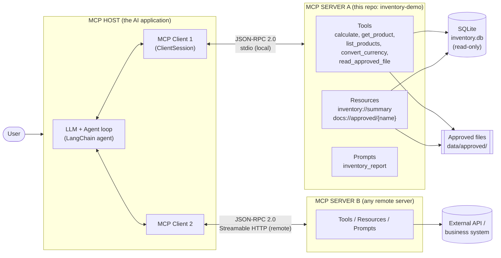
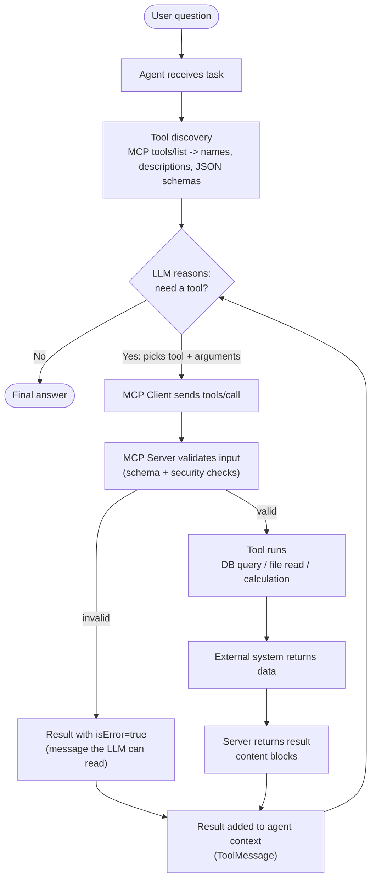
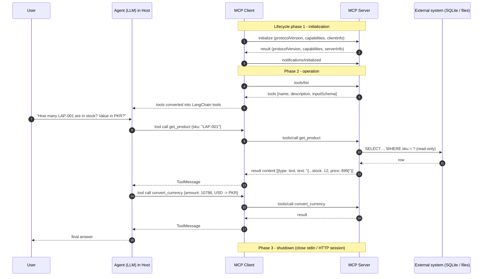
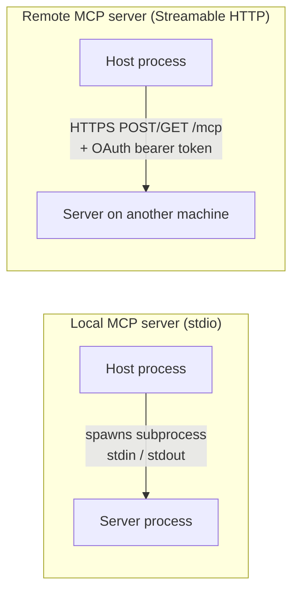

# MCP Diagrams

All diagrams are [Mermaid](https://mermaid.js.org/) and render automatically on GitHub.

## 1. MCP architecture (Host / Client / Server)

**Rule of thumb:** one Host runs many Clients; each Client keeps a dedicated 1:1 connection to one Server.

## 2. Agent-tool interaction flow

## 3. Communication sequence (what is on the wire)

## 4. Local vs remote deployment

